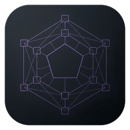
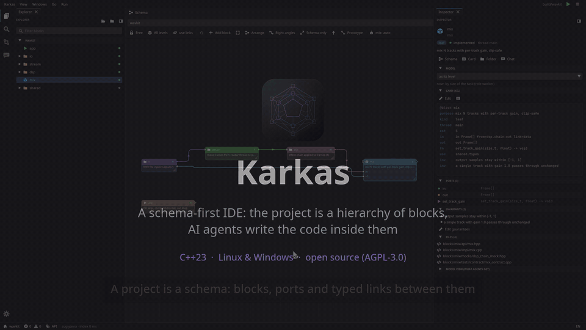
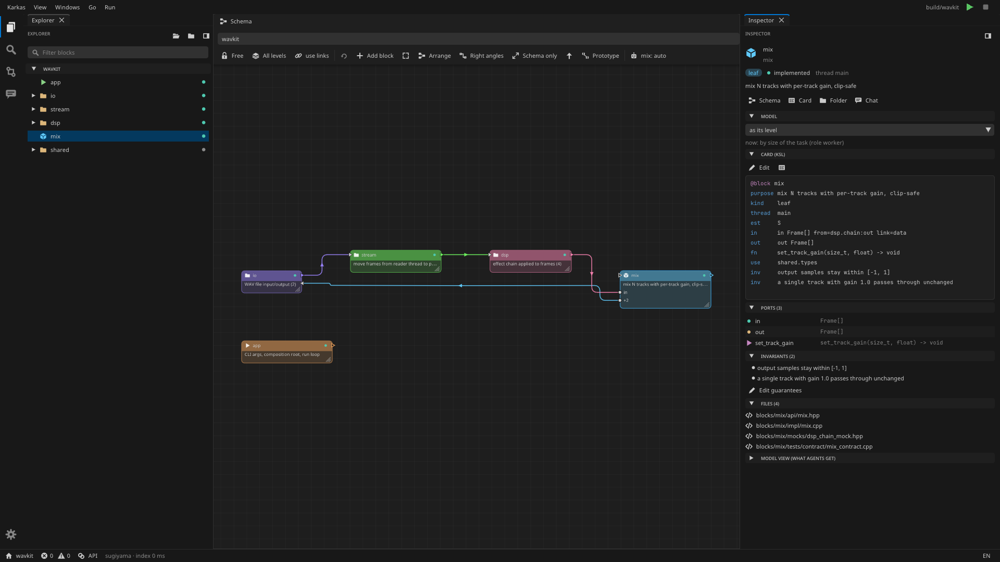
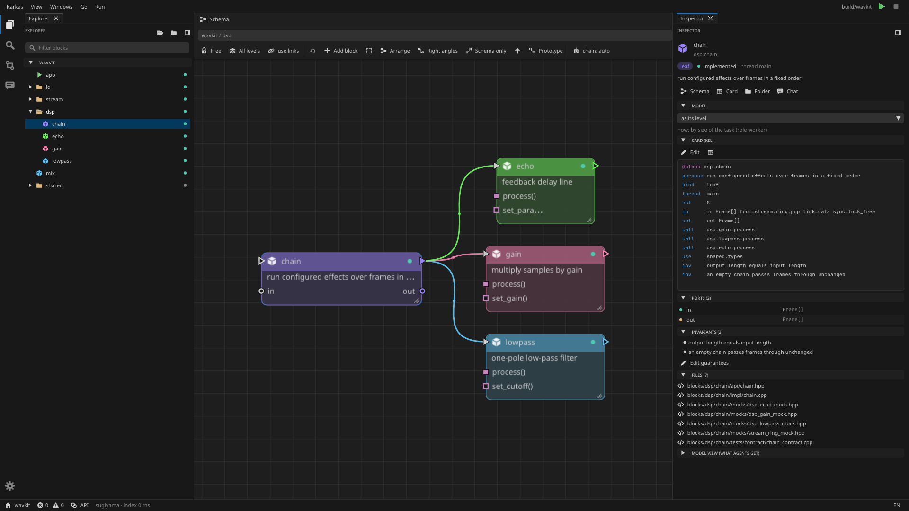
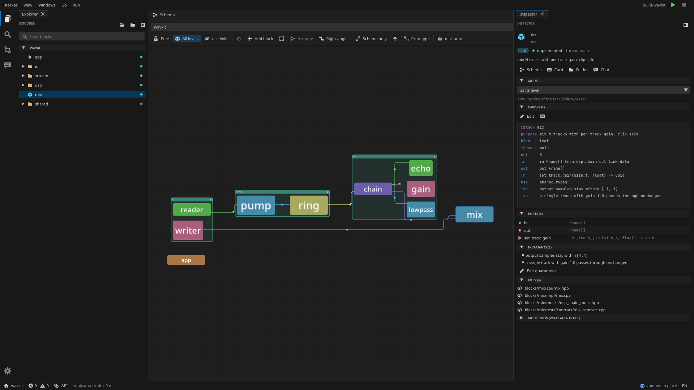
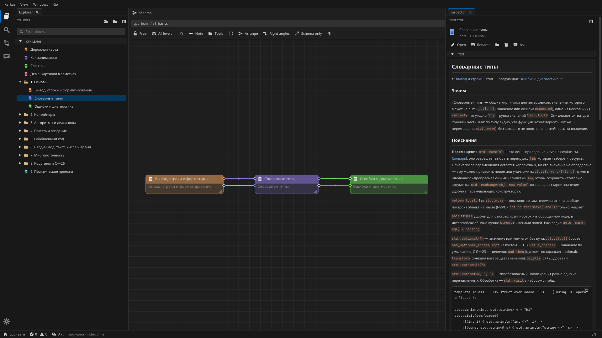
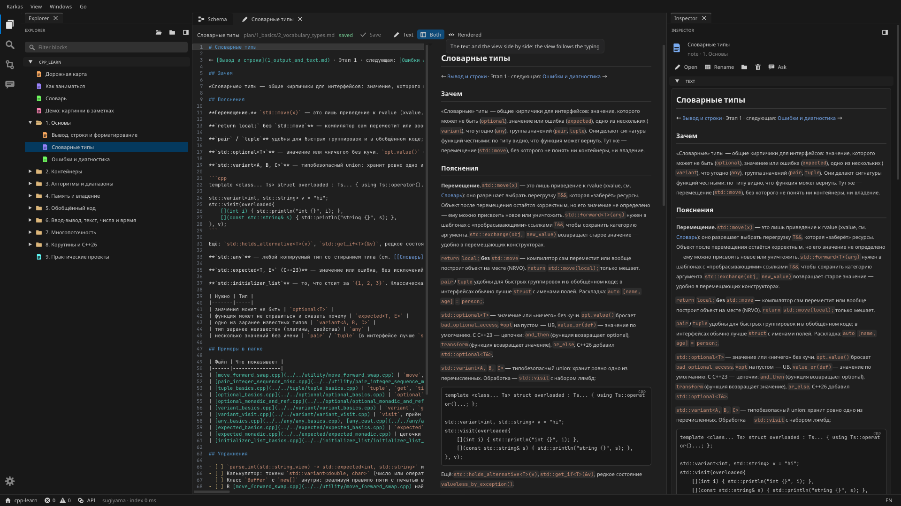
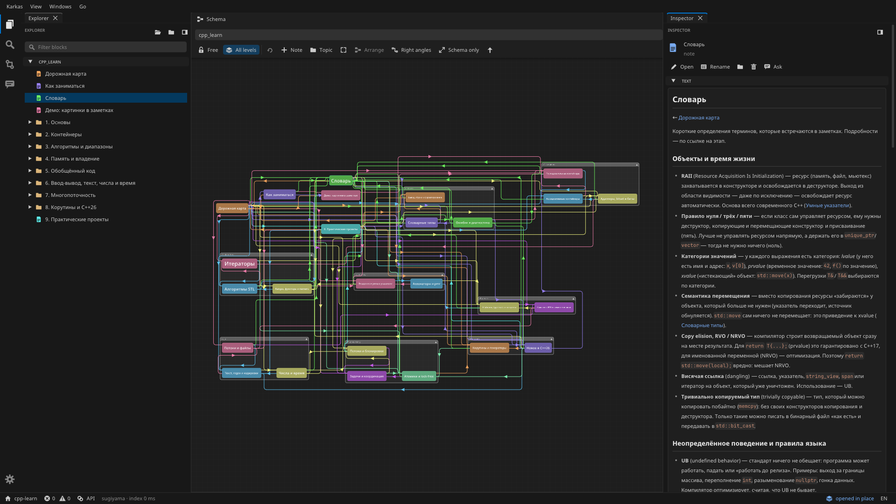
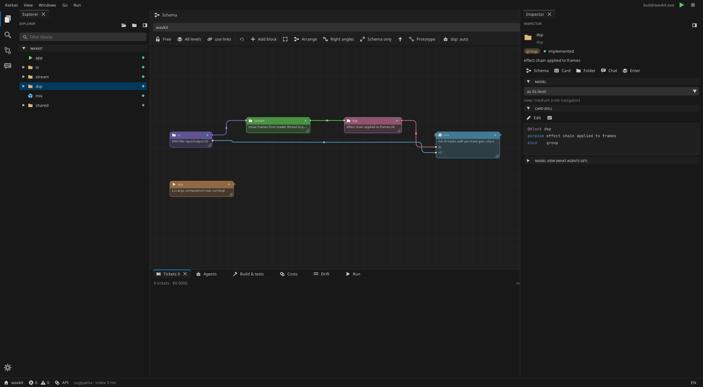

<p align="center">
  
</p>

<h1 align="center">Karkas</h1>

<p align="center">
  <b>A schema-first IDE: your project is a hierarchy of blocks, AI agents write the code inside them.</b><br>
  Deterministic index, drift control, tickets, an MCP server for Claude Code, a node-graph GUI.
</p>

<p align="center">
  <a href="https://github.com/AbdurahmanTFX/Karkas/releases/latest"></a>
  
  
  <a href="LICENSE"></a>
  <a href="https://m8ven.ai/mcp/abdurahmantfx-karkas-wvxva9?s=readme"></a>
</p>

<p align="center">
  <a href="README.ru.md">Русская версия</a> ·
  <a href="https://github.com/AbdurahmanTFX/Karkas/releases/latest">Download</a> ·
  <a href="docs/SPEC.txt">Specification (RU)</a>
</p>



<p align="center"><i>Full video (1080p, 80 s): <a href="https://github.com/AbdurahmanTFX/Karkas/releases/download/v0.1.1/karkas-demo.mp4">karkas-demo.mp4</a></i></p>

<!-- **Security and trust:**[](https://m8ven.ai/mcp/abdurahmantfx-karkas-wvxva9?s=readme) -->

## Why

AI coding agents re-learn a project on every task: they search files, read code and rebuild its structure
before they even start. The cost grows with the project, one expensive model does almost everything, and the
knowledge is lost between sessions. A person — especially a non-programmer — gets a black box.

Karkas («каркас» — *a frame, a skeleton*) turns this around. **The project is designed and kept as a schema
from day one:** a tree of blocks (block → sub-blocks → … → leaves) joined by typed links. Each block is a
folder with a short card in the KSL language, a real C++ interface header, its code and its tests.

- A strong model (the orchestrator) sees **only the schema**, never the code.
- Cheap models work **inside one block each**, in an isolated context.
- They talk through short structured **tickets** that are extended, never rewritten.
- Everything an algorithm can do is done **without AI**: the index, the checks, drift between the schema and
  the code, the picture, the test runs, the history.

A block card looks like this:

```text
@block mix
purpose mix N tracks with per-track gain, clip-safe
kind    leaf
thread  main
est     S
in      in Frame[] from=dsp.chain:out link=data
out     out Frame[]
fn      set_track_gain(size_t, float) -> void
use     shared.types
inv     output samples stay within [-1, 1]
inv     a single track with gain 1.0 passes through unchanged
```

## Features

**Schema and agents**
- KSL cards per block; links of kinds `data`, `event`, `call`, `use`; contracts become interfaces and tests.
- Agents by role (architect, testers, workers, orchestrator) with model routing per level and per block and
  escalation to a stronger model on failure; any Anthropic or OpenAI-compatible API (e.g. a local Ollama).
- Tickets, schema change proposals (`C-NNNN`) that a human approves, cost accounting per role and ticket.
- **MCP server** (`karkas mcp`): Claude Code on a subscription gets the schema, the method, the checks and the
  change proposals as tools.
- Import of existing C/C++ code: the files stay where they are, the cards point at them.

**Deterministic core**
- SQLite (FTS5) index with live file watching, schema queries (`children`, `path`, `dependents`, `drift`…).
- Drift control: tree-sitter analysis finds where the code no longer matches the schema.
- Generated CMake, mocks and probes; builds and tests through CMake/CTest with compressed logs.

**GUI** (Dear ImGui + imgui-node-editor)
- Navigate levels like folders; hover a block to see only its links; open every group in place ("All levels")
  with lines routed around the blocks.
- **Arrange**: a layered layout with few crossings and orthogonal line routes; lines with right angles.
- Inspector with the card, ports, guarantees and files; orchestrator chat; panels for tickets, agents,
  builds, costs and drift; a Run tab for the project's program.
- Locked mouse mode (look and select only) and "Schema only" (F11).
- **Notes mode**: a knowledge base as a graph of Markdown notes — `[[links]]`, rendering with tables and code,
  images by drag-and-drop or Ctrl+V, an AI assistant that proposes edits for you to approve.
- English and Russian interface.

## Screenshots

| | |
|---|---|
|  |  |
| The schema of a project and a block's card | The level of a group |
|  |  |
| All levels: groups opened in place, routed lines | Notes mode: Markdown rendered in the inspector |
|  |  |
| A note's text and its rendering side by side | A notes project with every topic opened |

<details>
<summary>The Windows build, running under wine</summary>


</details>

## Download

Release **[v0.1.1](https://github.com/AbdurahmanTFX/Karkas/releases/tag/v0.1.1)**:

| Package | Linux x86-64 | Windows x86-64 |
|---|---|---|
| **Karkas** — the application (the window and the CLI it runs) | [karkas-gui-0.1.1-linux-x86_64.tar.gz](https://github.com/AbdurahmanTFX/Karkas/releases/download/v0.1.1/karkas-gui-0.1.1-linux-x86_64.tar.gz) | [karkas-gui-0.1.1-windows-x86_64.zip](https://github.com/AbdurahmanTFX/Karkas/releases/download/v0.1.1/karkas-gui-0.1.1-windows-x86_64.zip) |
| **karkas** — the command line alone | [karkas-cli-0.1.1-linux-x86_64.tar.gz](https://github.com/AbdurahmanTFX/Karkas/releases/download/v0.1.1/karkas-cli-0.1.1-linux-x86_64.tar.gz) | [karkas-cli-0.1.1-windows-x86_64.zip](https://github.com/AbdurahmanTFX/Karkas/releases/download/v0.1.1/karkas-cli-0.1.1-windows-x86_64.zip) |

**Linux** — glibc 2.38 or newer (Ubuntu 24.04, Fedora 39, Debian 13, Arch…) with libcurl, SQLite 3 and
OpenGL 3.3. Unpack and run `./bin/karkas-gui`, or install it for yourself with a menu entry and the icon:

```sh
tar xf karkas-gui-0.1.1-linux-x86_64.tar.gz
cd karkas-gui-0.1.1-linux-x86_64
./install.sh            # into ~/.local;  sudo PREFIX=/usr/local ./install.sh for everyone
```

**Windows** 10/11 — unpack and run `karkas-gui.exe` (keep `karkas.exe` next to it). Each `.exe` is a single
static file. The Windows port is new: it is cross-compiled with MinGW-w64 and was tested under wine, not yet
on a real Windows machine — reports are welcome.

Agents need [Claude Code](https://claude.com/claude-code) (the `claude` command, on a subscription) or an API
key (`ANTHROPIC_API_KEY`, `OPENAI_API_KEY`, or any OpenAI-compatible endpoint set in the settings).

## Quick start

```sh
karkas init myproj --idea "a WAV mixer with effects"   # project.ksl, karkas.toml, .karkas/
cd myproj
karkas design          # the architect drafts the top level, then stops for you
karkas gui             # look at it, edit the cards
karkas approve L0
karkas expand --all    # groups and interfaces, then stops again
karkas approve api     # freeze, generate CMake, skeletons and mocks
karkas implement all   # testers and workers write the code
karkas test
```

An existing project: `karkas init .`, then `karkas import --dry-run` and `karkas import` — the code is cut
into blocks by folders and file pairs, your own CMakeLists.txt stays as it is.

With Claude Code on a subscription:

```sh
claude mcp add karkas -- karkas mcp --project "$PWD"
```

Everyday commands: `karkas task "add a reverb effect"`, `karkas debug "the sound crackles"`,
`karkas ticket list`, `karkas change list`, `karkas check`, `karkas query path io.reader mix`,
`karkas cost --by role`. A notes project is created from the GUI: "Karkas → New project…", notes mode.

## Build from source

Requirements: GCC 14+ or Clang 18+, CMake 3.29+, Ninja; SQLite 3 (FTS5), libcurl, OpenGL; optional ccache,
mold, Graphviz. The other libraries (Dear ImGui, imgui-node-editor, GLFW, tree-sitter, spdlog, fmt, CLI11,
toml++, nlohmann/json, doctest…) come from the system or are fetched at pinned versions.

```sh
cmake --preset dev && cmake --build --preset dev     # debug build with tests
ctest --preset dev                                   # 428 tests
cmake --workflow --preset package-linux              # release packages in build/package-linux/packages
cmake --workflow --preset package-windows            # Windows packages, cross-compiled with MinGW-w64
```

Arch Linux: `sudo pacman -S cmake ninja gcc sqlite curl glfw` (and `mingw-w64-gcc wine` for the Windows
build). The Windows build can be tested on Linux: `cmake --preset windows && cmake --build --preset windows`,
then `wine build/windows/libs/core/kk_core_tests.exe`.

## Repository

```text
apps/cli        karkas — the command line
apps/gui        karkas-gui — the window
libs/core       KSL, the model, config, tickets, the platform layer
libs/index      SQLite index, queries, file watcher
libs/code       tree-sitter analysis, generation, import, drift
libs/runner     processes, builds, tests
libs/llm        model APIs, the MCP bridge
libs/agents     roles, the engine, routing, tickets, the notes assistant
libs/mcp        the MCP server
libs/layout     layered layout and line routing
templates/      prompts and target-project templates (embedded into the binary)
packaging/      icon, .desktop entry, install scripts, Windows resources
docs/           SPEC.txt (the specification, in Russian), adr/ (decision records), progress.md
```

## Status

Version 0.1.1 — an early, working release. Linux is the main platform; the Windows port is new. The
specification and the decision records are in the repository; parts of the docs are in Russian.

## How it was made

Karkas is the author's project: the idea, the specification ([docs/SPEC.txt](docs/SPEC.txt)), the decisions
and the direction are **AbdurahmanTFX**'s. A large part of the code, the tests and the documentation was
written **with AI coding assistants — mainly Claude (Anthropic) through Claude Code** — working stage by stage
under the author's direction; commits made this way carry a `Co-Authored-By: Claude` line. The author set
every stage, checked the results on real projects, found and reported the bugs, and put a great deal of
personal time and effort into it. AI made the amount of code possible; the author made it the program it is.

## License

[GNU AGPL-3.0](LICENSE).
