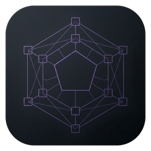
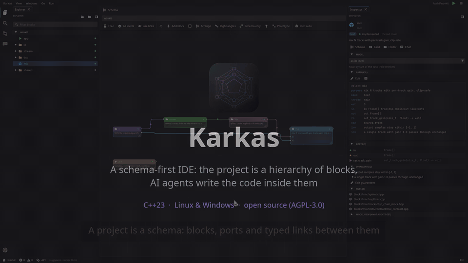
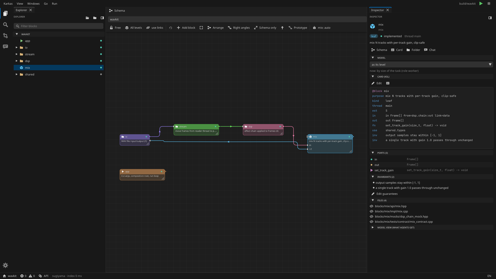
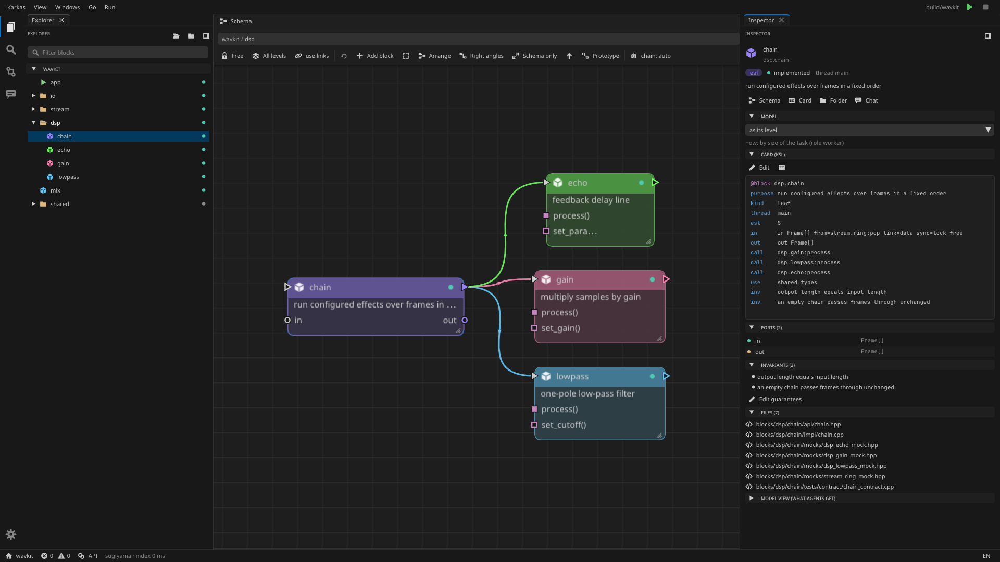
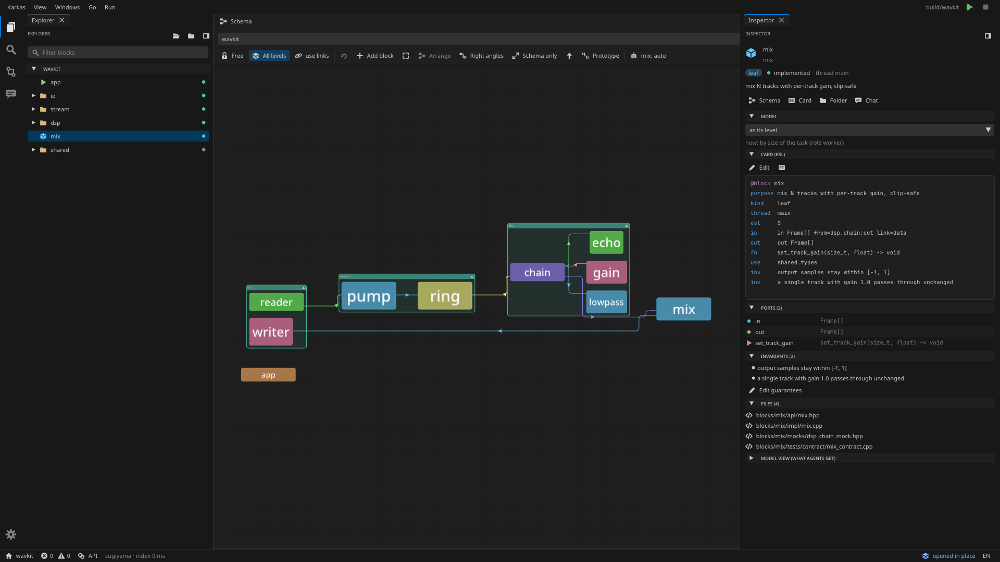
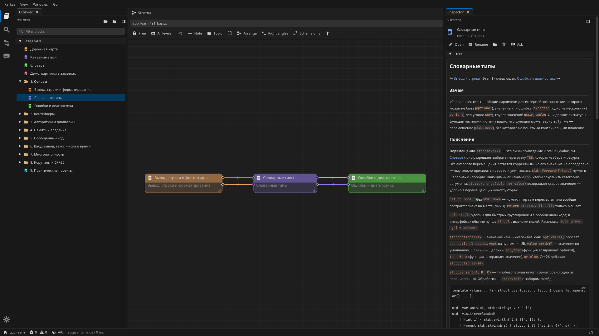
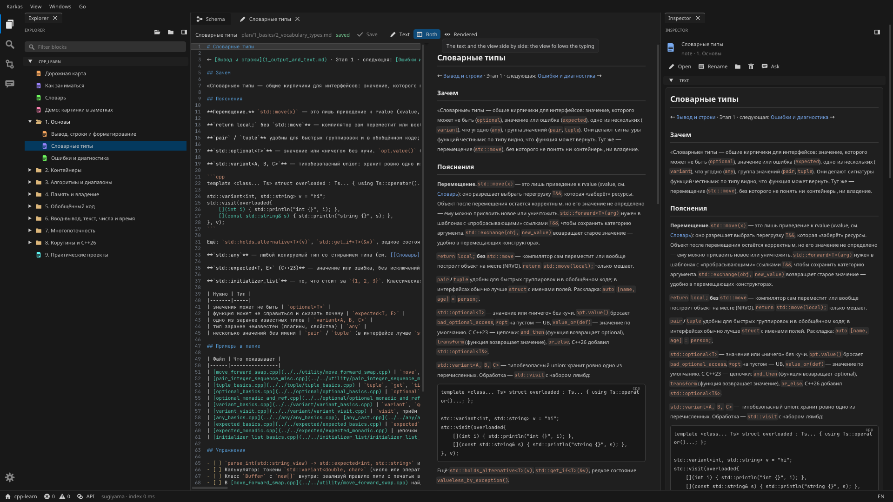
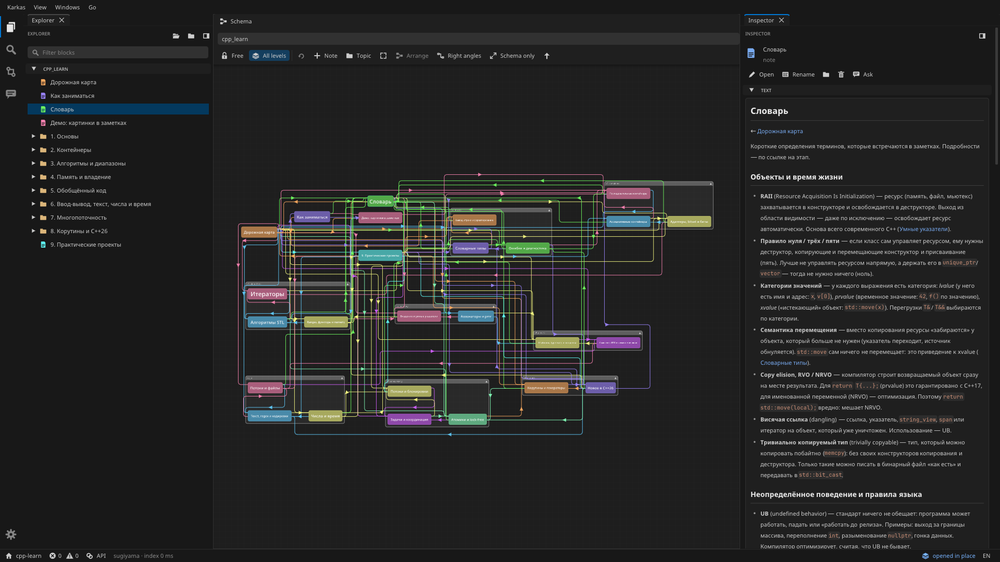
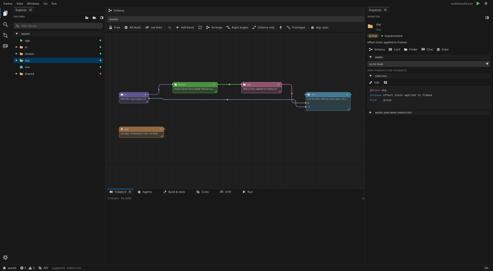

<p align="center">
  
</p>

<h1 align="center">Karkas</h1>

<p align="center">
  <b>Среда разработки, где проект — иерархическая схема блоков, а ИИ-агенты пишут код внутри них.</b><br>
  Детерминированный индекс, контроль расхождения кода и схемы, тикеты, MCP-сервер для Claude Code, GUI со схемой.
</p>

<p align="center">
  <a href="https://github.com/AbdurahmanTFX/Karkas/releases/latest"></a>
  
  
  <a href="LICENSE"></a>
</p>

<p align="center">
  <a href="README.md">English</a> ·
  <a href="https://github.com/AbdurahmanTFX/Karkas/releases/latest">Скачать</a> ·
  <a href="docs/SPEC.txt">Спецификация</a>
</p>



<p align="center"><i>Полное видео (1080p, 80 с): <a href="https://github.com/AbdurahmanTFX/Karkas/releases/download/v0.1.1/karkas-demo.mp4">karkas-demo.mp4</a></i></p>

## Зачем

ИИ-агенты для программирования при каждой задаче заново изучают проект: ищут файлы, читают код,
восстанавливают связи и только потом берутся за дело. Цена запроса растёт вместе с проектом, почти всю работу
делает одна дорогая модель, а знание о проекте между сессиями теряется. Человек, особенно не программист,
получает «чёрный ящик».

Karkas делает наоборот. **Проект с первого дня проектируется и хранится как схема:** дерево блоков
(блок → подблоки → … → листья), соединённых типизированными связями. Каждый блок — папка с короткой карточкой
на языке KSL, настоящим заголовком C++ с интерфейсом, кодом и тестами.

- Сильная модель (оркестратор) видит **только схему** и никогда не видит код.
- Дешёвые модели работают **каждая внутри своего блока**, в изолированном контексте.
- Общаются они короткими структурированными **тикетами**, которые дополняются, а не переписываются.
- Всё, что может сделать алгоритм, делается **без ИИ**: индекс, проверки, расхождение схемы и кода, картинка,
  запуск тестов, история.

Так выглядит карточка блока:

```text
@block mix
purpose mix N tracks with per-track gain, clip-safe
kind    leaf
thread  main
est     S
in      in Frame[] from=dsp.chain:out link=data
out     out Frame[]
fn      set_track_gain(size_t, float) -> void
use     shared.types
inv     output samples stay within [-1, 1]
inv     a single track with gain 1.0 passes through unchanged
```

## Возможности

**Схема и агенты**
- Карточки KSL у каждого блока; связи `data`, `event`, `call`, `use`; контракты превращаются в интерфейсы и тесты.
- Агенты по ролям (архитектор, тестировщики, исполнители, оркестратор), своя модель для каждого уровня и
  блока, эскалация к более сильной модели при неудаче; любой API Anthropic или совместимый с OpenAI
  (например, локальная Ollama).
- Тикеты, предложения изменений схемы (`C-NNNN`), которые утверждает человек, учёт затрат по ролям и тикетам.
- **MCP-сервер** (`karkas mcp`): Claude Code по подписке получает схему, метод, проверки и предложения
  изменений как инструменты.
- Импорт существующего кода на любом из 28 языков (C/C++, Python, JS/TS, Go, Rust, Java, Kotlin, C#, shell, Lua,
  Ruby, PHP, ...; `lang cpp python bash` в project.ksl): файлы остаются на месте, карточки ссылаются на них.
  C/C++ разбирает tree-sitter, остальные языки — детерминированные лексические правила (ADR 0051).

**Детерминированное ядро**
- Индекс на SQLite (FTS5) с отслеживанием файлов, запросы к схеме (`children`, `path`, `dependents`, `drift`…).
- Контроль дрейфа: анализ tree-sitter находит, где код разошёлся со схемой.
- Генерация CMake, моков и проб; сборка и тесты через CMake/CTest со сжатыми журналами.

**Окно** (Dear ImGui + imgui-node-editor)
- Уровни схемы открываются как папки; при наведении на блок видны только его связи; «Все уровни» раскрывают
  каждую группу на месте, линии идут в обход блоков.
- **Упорядочить**: послойная раскладка с минимумом пересечений и ортогональными трассами; линии с прямыми углами.
- Инспектор с карточкой, портами, гарантиями и файлами; чат с оркестратором; панели тикетов, агентов,
  сборки, затрат и дрейфа; вкладка «Запуск» для программы проекта.
- Заблокированный режим мыши (только смотреть и выделять) и «Только схема» (F11).
- **Режим заметок**: база знаний как граф Markdown-заметок — ссылки `[[…]]`, отображение с таблицами и кодом,
  картинки перетаскиванием или Ctrl+V, ИИ-ассистент, который предлагает правки на утверждение.
- Интерфейс на русском и английском.

## Скриншоты

| | |
|---|---|
|  |  |
| Схема проекта и карточка блока | Уровень группы |
|  |  |
| «Все уровни»: группы раскрыты на месте, линии в обход блоков | Режим заметок: Markdown в инспекторе |
|  |  |
| Текст заметки и результат рядом | Проект заметок со всеми раскрытыми темами |

<details>
<summary>Сборка для Windows под wine</summary>


</details>

## Скачать

Релиз **[v0.1.1](https://github.com/AbdurahmanTFX/Karkas/releases/tag/v0.1.1)**:

| Пакет | Linux x86-64 | Windows x86-64 |
|---|---|---|
| **Karkas** — приложение (окно и CLI, который оно запускает) | [karkas-gui-0.1.1-linux-x86_64.tar.gz](https://github.com/AbdurahmanTFX/Karkas/releases/download/v0.1.1/karkas-gui-0.1.1-linux-x86_64.tar.gz) | [karkas-gui-0.1.1-windows-x86_64.zip](https://github.com/AbdurahmanTFX/Karkas/releases/download/v0.1.1/karkas-gui-0.1.1-windows-x86_64.zip) |
| **karkas** — только командная строка | [karkas-cli-0.1.1-linux-x86_64.tar.gz](https://github.com/AbdurahmanTFX/Karkas/releases/download/v0.1.1/karkas-cli-0.1.1-linux-x86_64.tar.gz) | [karkas-cli-0.1.1-windows-x86_64.zip](https://github.com/AbdurahmanTFX/Karkas/releases/download/v0.1.1/karkas-cli-0.1.1-windows-x86_64.zip) |

**Linux** — glibc 2.38 и новее (Ubuntu 24.04, Fedora 39, Debian 13, Arch…), в системе нужны libcurl,
SQLite 3 и OpenGL 3.3. Распакуйте и запустите `./bin/karkas-gui` или установите для себя с пунктом меню и иконкой:

```sh
tar xf karkas-gui-0.1.1-linux-x86_64.tar.gz
cd karkas-gui-0.1.1-linux-x86_64
./install.sh            # в ~/.local;  sudo PREFIX=/usr/local ./install.sh — для всех
```

**Windows** 10/11 — распакуйте и запустите `karkas-gui.exe` (`karkas.exe` должен лежать рядом). Каждый `.exe` —
один статический файл. Порт на Windows новый: он собран кросс-компилятором MinGW-w64 и проверен под wine,
на настоящей Windows ещё не запускался — сообщения о проблемах приветствуются.

Агентам нужен [Claude Code](https://claude.com/claude-code) (команда `claude`, по подписке) или ключ API
(`ANTHROPIC_API_KEY`, `OPENAI_API_KEY` или любой совместимый с OpenAI адрес в настройках).

## Как пользоваться

### Новый проект

```sh
karkas init myproj --idea "..."    # project.ksl, karkas.toml, .karkas/
cd myproj
karkas design                      # архитектор: верхний уровень → ОСТАНОВКА
karkas view / karkas gui           # посмотреть, поправить карточки
karkas approve L0
karkas expand --all                # раскрытие групп и api/ листьев → ОСТАНОВКА
karkas approve api                 # заморозка + gen cmake/skel/mocks/probe
karkas implement all               # тестировщики, исполнители, корень сборки
karkas test
```

Из GUI: «Karkas → Новый проект…» (Ctrl+N) — в новой папке или в существующей.

### Существующий проект

```sh
cd ~/мой/проект
karkas init .                      # каркас: project.ksl, karkas.toml, .karkas/
karkas import --dry-run            # что получится: группы по папкам, блоки по парам файлов
karkas import                      # предложение C-NNNN → утвердить во вкладке «Изменения»
                                   # GUI или karkas approve C-NNNN
```

Из GUI: «Новый проект → В существующей папке» с галочкой «Разрезать код на блоки» делает
то же самое за один шаг.

Код не переносится: карточки лежат в blocks/, а в них строка `files` указывает на
существующие файлы (docs/adr/0009). Свой CMakeLists.txt остаётся как был.

### Claude Code по подписке (MCP)

```sh
karkas gen guide                   # CLAUDE.md с методом Karkas (init делает это сам)
claude mcp add karkas -- karkas mcp --project "$PWD"
```

Claude Code при старте читает CLAUDE.md, а MCP-сервер даёт ему схему (kk_overview, kk_view…),
метод (kk_guide), синтаксис карточек (kk_ksl_reference), проверки (kk_check, kk_run_tests) и
предложения изменений схемы (kk_propose_change → C-NNNN). Утверждает изменения всегда
человек: вкладка «Изменения» в GUI или `karkas approve C-NNNN` (docs/adr/0012).

### Работа с проектом

```sh
karkas task "добавить эффект reverb"
karkas debug "звук трещит" --fact "contract stream.ring FAIL"
karkas ticket list | show T-0001 --path
karkas change list | show C-0001 ; karkas approve C-0001
karkas check | index --watch | view stream | query path io.reader mix
karkas cost --by role
karkas mcp --project .             # для Claude Code: claude mcp add karkas -- karkas mcp --project <dir>
karkas bench run --scenario s3 --method C --reps 3 ; karkas bench report
```

### Окно (GUI)

```sh
karkas gui                         # или karkas-gui --project <dir>
```

Окно устроено как IDE (по образцу VSCode/Godot): слева полоса активности — проводник блоков,
поиск, изменения схемы, настройки; в центре редактор с вкладками (схема и открытые файлы
кода); справа инспектор; снизу тикеты, агенты, сборка, затраты, дрейф; внизу строка состояния.

Навигация: адресная строка сверху (щелчок по части пути или ввод пути); наведение на блок
оставляет видимыми только его связи, Shift+щелчок закрепляет подсветку (можно несколько
блоков), Shift+двойной щелчок раскрывает группу на месте (закрыть — щелчок по полосе пути
на рамке). Проекты: «Karkas → Открыть проект…» (Ctrl+O), недавние, «Открыть папку».

Связи удаляются правым щелчком по линии (одна связь или все связи линии) или клавишей Delete
по выделенной линии; перед удалением показывается изменение KSL.

Настройки открываются отдельным окном (шестерёнка или Ctrl+,): внешний вид, схема, модели и
API, справка. Язык интерфейса (English / Русский), размер блоков по умолчанию и размер текста
сохраняются в ~/.config/karkas/gui.json (Windows: %APPDATA%\karkas\gui.json). Размер блока
меняется перетаскиванием его правого нижнего угла (минимум 120 × 56), текст масштабируется
под размер; позиции и размеры хранятся в .karkas/layout/.

### Модели и API по уровням

Каждому уровню дерева блоков и каждому блоку можно дать свою модель и свой API
(docs/adr/0011). В GUI — кнопка модели на панели схемы (уровень и выбранный блок), раздел
«Модель» в инспекторе и страница «Модели и API» в настройках. В karkas.toml:

```toml
[models.local]                     # ещё один API рядом с strong/medium/cheap
provider    = "openai_compat"
model       = "qwen3-coder"
base_url    = "http://localhost:11434/v1"
api_key_env = "OLLAMA_API_KEY"     # имя переменной; сам ключ в файлы не пишется

[levels]
0 = "strong"                       # проект: оркестратор, архитектор верхнего уровня
2 = "cheap"

[blocks]
"world.pickups" = "local"          # блок и всё внутри него
```

Порядок: свой блок → уровень → роль ([roles]) и маршрутизация по размеру задачи.
Ключи — только в переменных окружения (по умолчанию ANTHROPIC_API_KEY / OPENAI_API_KEY).
Цены моделей — в [prices] (сверить с официальной страницей).

## Сборка из исходников

Нужны GCC 14+ или Clang 18+, CMake 3.29+, Ninja; SQLite 3 (FTS5), libcurl, OpenGL; по желанию ccache, mold,
Graphviz. Остальные библиотеки (Dear ImGui, imgui-node-editor, GLFW, tree-sitter, spdlog, fmt, CLI11, toml++,
nlohmann/json, doctest…) берутся из системы или скачиваются фиксированных версий.

```sh
cmake --preset dev && cmake --build --preset dev     # отладочная сборка с тестами
ctest --preset dev                                   # 428 тестов
cmake --preset headless && cmake --build --preset headless     # без GUI
cmake --workflow --preset package-linux              # пакеты: build/package-linux/packages
cmake --workflow --preset package-windows            # пакеты Windows, кросс-компилятор MinGW-w64
```

Arch Linux: `sudo pacman -S cmake ninja gcc sqlite curl glfw` (и `mingw-w64-gcc wine` для сборки под Windows).
Для Graphviz-раскладки — `sudo pacman -S graphviz` и пересборка (иначе встроенный алгоритм Сугиямы). Сборку
для Windows можно проверить на Linux: `cmake --preset windows && cmake --build --preset windows`, затем
`wine build/windows/libs/core/kk_core_tests.exe`.

## Устройство репозитория

```text
apps/cli        karkas — командная строка
apps/gui        karkas-gui — окно
libs/core       KSL, модель, конфигурация, тикеты, платформенный слой
libs/index      индекс на SQLite, запросы, наблюдение за файлами
libs/code       анализ tree-sitter, генерация, импорт, дрейф
libs/runner     процессы, сборка, тесты
libs/llm        API моделей, мост MCP
libs/agents     роли, движок, маршрутизация, тикеты, ассистент заметок
libs/mcp        MCP-сервер
libs/layout     послойная раскладка и трассировка линий
templates/      промпты и шаблоны целевых проектов (встраиваются в программу)
packaging/      иконка, .desktop, скрипты установки, ресурсы Windows
docs/           SPEC.txt (спецификация), adr/ (записи решений), progress.md (состояние по этапам)
```

## Состояние

Версия 0.1.1 — ранний рабочий релиз. Основная платформа — Linux, порт на Windows новый. Спецификация и
записи решений лежат в репозитории.

## Как это сделано

Karkas — проект автора: идея, спецификация ([docs/SPEC.txt](docs/SPEC.txt)), решения и направление работы
принадлежат **AbdurahmanTFX**. Большая часть кода, тестов и документации написана **с помощью ИИ-ассистентов —
в основном Claude (Anthropic) через Claude Code**, — которые работали по этапам под руководством автора;
такие коммиты помечены строкой `Co-Authored-By: Claude`. Автор ставил каждый этап, проверял результат на
настоящих проектах, находил ошибки и вложил в проект очень много своего времени и сил. ИИ сделал возможным
такой объём кода; программой его сделал автор.

## Лицензия

[GNU AGPL-3.0](LICENSE).
